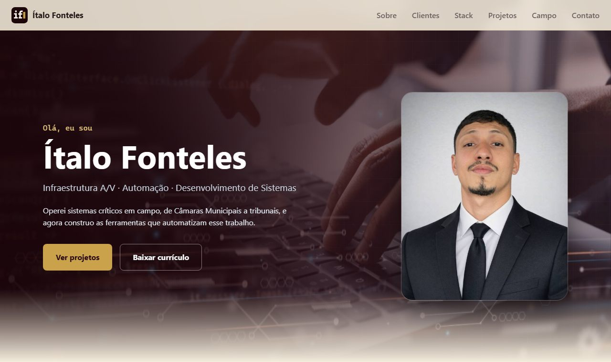

# Portfólio · Ítalo Fonteles

Portfólio profissional de **infraestrutura de TI e audiovisual, automação e desenvolvimento de sites e sistemas**. Reúne clientes atendidos, projetos de software e cases de campo em ambientes de missão crítica, como Câmaras Municipais e tribunais.

Atendendo empresas e escritórios em **Boa Vista - RR**.

🌐 **Site:** https://italofonteles.github.io/portfolio-profissional/
📄 **Currículo:** [assets/curriculo.pdf](assets/curriculo.pdf)



---

## Sobre o projeto

O portfólio conta uma trajetória: **anos instalando e mantendo sistemas em campo e, agora, criando as ferramentas e soluções que levam esse conhecimento para empresas**. O site se organiza em quatro frentes:

- **Clientes:** sites entregues e no ar, com print e link para cada um.
- **Projetos:** soluções em sites, automação (n8n, Docker), infraestrutura e sistemas, pensadas para o mercado local.
- **Experiência de campo:** cases de infraestrutura A/V, TI e elétrica, no formato *problema → minha participação → solução → resultado*.
- **Contato:** formulário que abre o WhatsApp com a mensagem pronta.

## Funcionalidades

- **Seção Clientes** com o print de cada site numa "janela de navegador" e efeito ao passar o mouse.
- Projetos e cases renderizados a partir de arquivos **JSON** (para adicionar um item, basta editar o JSON, sem mexer no HTML).
- **Filtro de projetos** por categoria (Sites, Automação, Infraestrutura, Sistemas), gerado automaticamente a partir dos dados.
- **Fundos com efeito:** imagem com zoom lento no topo, parallax na Stack, manchas de luz animadas em Projetos e Campo e código binário em movimento no Contato.
- Vídeos dos cases que tocam e pausam conforme entram e saem da tela.
- Animações de aparecer ao rolar (`IntersectionObserver`).
- Linha do tempo da trajetória (Riole → ADS → Automação).
- **Currículo em PDF** gerado a partir de uma página HTML, com o mesmo visual do site.
- Menu responsivo com versão mobile.
- Conteúdo dos JSON escapado antes de ir para o HTML, evitando injeção de código.
- Respeita a preferência do sistema por menos animação (`prefers-reduced-motion`): os fundos animados ficam parados.

## Tecnologias

| Camada | Uso |
|--------|-----|
| HTML5 | Estrutura semântica |
| CSS3 | Variáveis, Grid, Flexbox, pseudo-elementos, `@keyframes`, filtros e máscaras, media queries |
| JavaScript (ES6+) | `fetch`, `async/await`, `IntersectionObserver`, manipulação do DOM |
| Git / GitHub | Versionamento e hospedagem |
| GitHub Pages | Publicação do site |

Sem frameworks e sem etapa de build: o projeto é HTML, CSS e JavaScript puros.

## Visual

Tema **vinho e dourado** sobre fundo champanhe, alternando seções claras e escuras:

| Seção | Fundo |
|-------|-------|
| Topo | Foto escurecida em tom vinho, zoom lento e grade "tech" |
| Clientes / Stack | Dourado claro; a Stack tem uma imagem de código com parallax |
| Projetos | Manchas de luz dourada e vinho flutuando + pontilhado |
| Experiência de campo | Fundo claro com luzes e linhas de circuito; cards dos vídeos escuros para destacar o vídeo |
| Contato | Grafite com código binário suave em movimento |

## Estrutura de pastas

```
portfolio-profissional/
├── index.html
├── css/
│   ├── base.css          # variáveis de tema (cores, fontes), reset e tipografia
│   └── components.css    # navbar, hero, clientes, cards, cases, contato e fundos animados
├── js/
│   ├── utils.js          # esc(): escapa texto antes de ir para o HTML
│   ├── main.js           # menu mobile e animação de reveal
│   ├── projetos.js       # renderiza projetos e filtros
│   ├── cases.js          # renderiza a experiência de campo
│   └── contato.js        # formulário de contato via WhatsApp
├── data/
│   ├── projetos.json     # projetos (sites, automação, infraestrutura, sistemas)
│   └── cases.json        # cases de campo
├── curriculo/
│   └── index.html        # fonte do currículo (gera o PDF)
└── assets/
    ├── curriculo.pdf
    ├── img/              # foto, fundos, prints dos clientes e prévia
    └── video/            # vídeos dos cases
```

## Como rodar localmente

Os dados são carregados com `fetch`, que **não funciona abrindo o `index.html` direto no navegador** (protocolo `file://`). É preciso um servidor local.

**Opção 1: VS Code**

1. Instale a extensão **Live Server**.
2. Abra a pasta do projeto e clique em **Go Live** na barra de status.

**Opção 2: Python**

```bash
git clone https://github.com/ItaloFonteles/portfolio-profissional.git
cd portfolio-profissional
python -m http.server 5500
```

Depois acesse `http://localhost:5500`.

## Como adicionar conteúdo

**Novo projeto:** acrescente um objeto em `data/projetos.json`.

```json
{
  "titulo": "Nome do projeto",
  "resumo": "O que ele faz, em uma ou duas frases.",
  "tags": ["Python", "Docker"],
  "categoria": "automacao",
  "status": "Em desenvolvimento",
  "repo": "https://github.com/ItaloFonteles/nome-do-repo",
  "demo": null
}
```

- `categoria`: `sites`, `automacao`, `infra` ou `sistemas`. Cada categoria cria seu botão de filtro automaticamente (o nome exibido fica em `ROTULOS`, no `js/projetos.js`).
- `repo` e `demo` aceitam um link ou `null`. Com `null`, o botão não aparece.

**Novo case de campo:** acrescente um objeto em `data/cases.json`.

```json
{
  "titulo": "Nome do case",
  "local": "Órgão ou empresa · projeto Riole",
  "video": "assets/video/arquivo.mp4",
  "poster": null,
  "problema": "O desafio do local.",
  "papel": "O que eu fiz nesse trabalho.",
  "solucao": ["Item 1", "Item 2"],
  "resultado": "O que foi entregue.",
  "tags": ["Tecnologia 1", "Tecnologia 2"]
}
```

- `papel` é opcional e aparece como **"Minha participação"**.

**Novo cliente:** copie um bloco `<article class="cliente">` da seção `#clientes` no `index.html`, troque o nome, a descrição, o link e o print (salve em `assets/img/`, em 960×600).

## Currículo

O PDF é gerado a partir de `curriculo/index.html`. Depois de editar o texto, rode na raiz do projeto (Windows, com o Microsoft Edge):

```bash
"/c/Program Files (x86)/Microsoft/Edge/Application/msedge.exe" --headless=new --no-pdf-header-footer --print-to-pdf="C:\\portfolio-novo\\assets\\curriculo.pdf" "file:///C:/portfolio-novo/curriculo/index.html"
```

O botão **"Baixar currículo"** do site aponta para `assets/curriculo.pdf`.

## Personalização

Todas as cores, fontes e medidas ficam nas variáveis do `:root` em `css/base.css`:

- `--accent` / `--accent-hover`: vinho (botões, links, destaques)
- `--gold`: dourado (detalhes, bordas, botões nas seções escuras)
- `--bg` / `--bg-alt` / `--surface`: fundos e cards

## Publicação

O site é publicado com **GitHub Pages**, a partir da branch `main` (pasta raiz). Cada `git push` atualiza o site em poucos minutos.

## Contato

- E-mail: italofontelles@gmail.com
- WhatsApp: (95) 99161-8031
- LinkedIn: [Ítalo Fonteles](https://www.linkedin.com/in/italo-fonteles-543984356/)
- GitHub: [@ItaloFonteles](https://github.com/ItaloFonteles)

---

© Ítalo Fonteles. O conteúdo textual, a foto de perfil e os vídeos dos cases são de uso exclusivo do autor. Os prints dos sites de clientes são exibidos com autorização. As imagens de fundo são de terceiros e pertencem aos seus respectivos autores.
